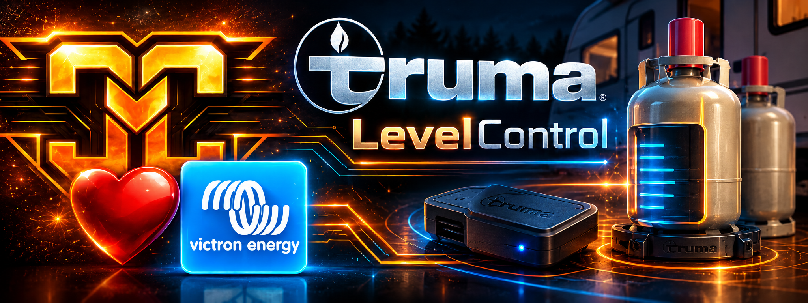

<p align="center">
  
</p>

<h1 align="center">🔥 dbus-truma-level-control</h1>
<h3 align="center">Truma LevelControl as an LPG tank sensor in Victron Venus OS – powered by native BlueZ</h3>

<p align="center">
  
  
  
  
  
</p>

<p align="center">
  <a href="README.md">🇩🇪 Deutsch</a> · <strong>🇬🇧 English</strong>
</p>

---

## 🚧 Beta – testers and ideas welcome!

**This project is still in testing.** Working with the Venus OS Bluetooth stack can be challenging. Feel free to test it and share bug reports, experiences, and ideas!

The long-term goal is to support native integration and control of additional Bluetooth sensors and devices in Venus OS – **without Node-RED or similar workarounds**. This is a roadmap idea, not a currently implemented feature.

> ⚠️ Experimental software: Start with non-critical setups, and monitor other Bluetooth sensors connected to your GX device.

## 🚀 About this project

**dbus-truma-level-control** integrates a Truma LevelControl sensor as an **LPG tank** on Victron GX devices running **Venus OS**. It uses the system's existing Bluetooth stack (`bluetoothd` / BlueZ): **no bleak, no pip, no extra Python packages**.

Readings are published through a standard tank D-Bus service and can be used in the local GUI, Remote Console, and supported Venus OS interfaces.

The underlying protocol is documented here: [cyclemat/HAOS-Truma-Levelcontrol-Integration](https://github.com/cyclemat/HAOS-Truma-Levelcontrol-Integration).

## ✨ Features and architecture

- 🔵 **Native BlueZ integration:** Connections, GATT requests, and discovery when needed use the BlueZ D-Bus API; no raw HCI control commands or adapter setting changes.
- 📡 **Advertisement-aware connections:** The HCI monitor channel is observed read-only (similar to `btmon`) to connect when the sensor is advertising.
- ⏱️ **Short sessions:** Connect → trigger measurement → read → disconnect. Connections last just a few seconds.
- 🧴 **Multiple cylinders:** Sensors are read sequentially, never at the same time.
- 🔎 **Discovery on demand:** Discovery is performed only if `bluetoothd` does not yet know the device, with backoff after failures.
- ⚡ **Standard Venus OS tank integration:** `com.victronenergy.tank.truma_<mac>` and LPG fluid type for GUI, VRM, MQTT, and Modbus, where supported and enabled in the local Venus OS setup.

## 📋 Requirements

- A Victron GX device running Venus OS with functional Bluetooth/BlueZ.
- Root access over SSH.
- A Truma LevelControl sensor within range during setup.
- The Truma app must not hold a connection during measurements.

## 📦 Installation

The following commands assume that you already have the `dbus-truma-levelcontrol.tar.gz` archive on your computer.

```sh
# On your computer: copy the archive to the GX device
scp dbus-truma-levelcontrol.tar.gz root@<gx-ip>:/data/

# On the GX device: extract and configure
cd /data && tar xzf dbus-truma-levelcontrol.tar.gz
cd /data/dbus-truma-levelcontrol
cp config.example.ini config.ini

# Find the sensor (up to 5 minutes; close the Truma app)
python3 dbus_truma_levelcontrol.py --find

# Enter the MAC address under [sensor1]
vi config.ini

# Perform one test reading
python3 dbus_truma_levelcontrol.py --once --debug

# Install the persistent service
sh install.sh
```

`install.sh` configures the service to be restored after regular Venus OS updates.

### 🛠️ Maintenance and diagnostics

| Action | Command |
| --- | --- |
| Follow logs | `tail -F /var/log/dbus-truma-levelcontrol/current \| tai64nlocal` |
| Stop service | `svc -d /service/dbus-truma-levelcontrol` |
| Start service | `svc -u /service/dbus-truma-levelcontrol` |
| Restart service | `svc -t /service/dbus-truma-levelcontrol` |
| One-off reading | `python3 dbus_truma_levelcontrol.py --once --debug` |
| Uninstall | `sh uninstall.sh` |

**Important:** Stop the running service before using `--once`. The sensor accepts **only one connection at a time**.

## ⚙️ Configuration

All options are documented in `config.example.ini`. Edit your own `config.ini`.

- Set the first sensor's MAC address under `[sensor1]`.
- Add `[sensor2]` for a second cylinder.
- If other BLE sensors are affected, adjust the connection windows as described below.

## 📶 Testing compatibility with other Bluetooth sensors

The only reliable way to determine interference with other BLE devices is to test on the actual GX hardware and Venus OS version in use.

1. Leave other BLE sensors (e.g., Ruuvi, Mopeka, or SmartShunt Instant Readout) active and monitor whether readings keep updating in the GUI or via `dbus -y`.
2. Run `dbus-truma-level-control` while capturing traffic with `btmon`.
3. Watch for `LE Set Scan Enable` and `LE Set Scan Parameters`, and check that the other sensors continue providing fresh readings.

If other sensors stop updating, these settings may help:

```ini
connect_window = 0
hinted_connect_window = 25
```

With `connect_window = 0`, a connection is attempted only after an advertisement was seen. Reducing `hinted_connect_window` shortens the corresponding window. **Test on your own setup; this does not guarantee that Bluetooth conflicts will disappear.**

## 🔌 D-Bus integration

Each sensor is exposed through a service named like `com.victronenergy.tank.truma_<mac>`.

| D-Bus path | Description |
| --- | --- |
| `/Level` | Sensor-reported fill level in % |
| `/Remaining` | Remaining volume in m³ (calculated from kg and `lpg_density`) |
| `/Capacity` | Tank capacity in m³ (calculated from kg and `lpg_density`) |
| `/FluidType` | `8` = LPG |
| `/Temperature` | Temperature in °C |
| `/Status` | `0` = OK, `1` = no new reading for longer than `stale_after` |
| `/Truma/GasKg` | Gas mass in kg |
| `/Truma/BatteryPercent` | Sensor battery level in % |
| `/Truma/Quality` | Measurement quality from 0 to 3 |
| `/Truma/LastReading` | Unix timestamp of the most recent reading |
| `/Truma/Raw` | Decrypted raw bytes (debug) |

## ⚠️ Known limitations

- **Single connection:** Close the Truma app during readings; do not run `--once` while the service is active.
- **`vesmart-server`:** Victron's BLE service for VictronConnect may terminate third-party BLE connections. A community patch exists at [TechBlueprints/victron-bluetooth-safety](https://github.com/TechBlueprints/victron-bluetooth-safety). Review external patches independently before applying them.
- **Temperature:** Parsed as a signed byte; negative-temperature behavior still needs verification.
- **After reboot:** If `bluetoothd` no longer knows the sensor, a short discovery is initiated.
- **Beta:** Bluetooth behavior may vary across Venus OS versions and GX hardware.

## 🧩 Protocol and related projects

The Truma LevelControl protocol work is documented in [HAOS-Truma-Levelcontrol-Integration](https://github.com/cyclemat/HAOS-Truma-Levelcontrol-Integration).

## 🛠️ Feedback and contributions

Bug reports, test results from different GX devices, and suggestions are welcome. For Bluetooth problems, please include your Venus OS version, GX hardware, connected sensors, and relevant logs with personal information removed.

- [CycleMat on GitHub](https://github.com/cyclemat)

## ❤️ Support and donations

This is a free-time community project available at no cost. If you'd like to support further development, donations are entirely optional:

**[☕ Support CycleMat via PayPal](https://paypal.me/cyclemat)**

No obligation, no paywall – just an open community project. ❤️

## 📄 Trademark disclaimer

This independent community project is not officially affiliated with Truma or Victron Energy. All trademarks belong to their respective owners.

---

<p align="center"><strong>CycleMat · Connecting Bluetooth sensors to Venus OS.</strong></p>
